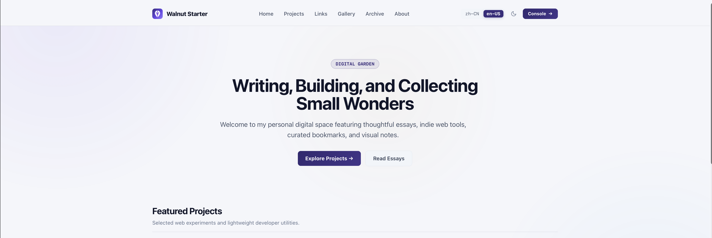

<div align="center">

# walnut-edge-cms-community

**A lightweight, edge-native CMS built for Cloudflare Workers, D1, and R2.**

[English](./README.md) · [简体中文](./README.zh-CN.md)

[](https://github.com/Meirgoo/walnut-edge-cms-community/releases)
[](https://workers.cloudflare.com/)
[](#license)

[Website](https://walnut.meirgoo.com) · [Live Demo](https://walnut-demo.meirgoo.com) · [Issues](https://github.com/Meirgoo/walnut-edge-cms-community/issues)

</div>

> **Beta Notice (`v0.9.0-beta.2`)**: Walnut CMS Community Edition is currently in public beta. The core engine, multi-site architecture, and official `Univers` theme are running stably in production, while documentation and UX details continue to be refined. Feedback and issue reports are welcome.

<picture>
  <source media="(prefers-color-scheme: dark)" srcset="./repo_static/exmaple_dark.png">
  <source media="(prefers-color-scheme: light)" srcset="./repo_static/exmaple.png">
  
</picture>

---

## What is Walnut CMS?

`walnut-edge-cms-community` is an edge site-building tool deployed on Cloudflare Workers. Designed from the ground up for the Cloudflare edge ecosystem, it offers:

- **Edge-native, zero VPS maintenance**: Runs directly on Cloudflare Workers + D1 + R2 with a minimal memory footprint and millisecond-level responses, fitting comfortably within Cloudflare's free tier.
- **Multi-format content management**: Native support for long-form articles (Markdown, bidirectional links, multi-language), lightweight micro-content streams, and custom structured datasets (projects, reading lists, curated links, etc.).
- **Decoupled themes and data**: One-click theme switching via ZIP or Git import without losing content; built-in AI contracts allow external AI tools to generate compatible themes and pages directly.
- **Multi-site & Zero Trust security**: Host unlimited sites on a single Worker instance with native Cloudflare Access protection for the admin console.

---

## Quick Start

### Prerequisites

- A [Cloudflare](https://dash.cloudflare.com/) account with Workers, D1, R2, and Zero Trust Access enabled (Zero Trust Free includes up to 50 active users at no cost for personal use)
- Node.js `>= 20` installed locally
- Analytics Engine enabled in Cloudflare (optional; can be skipped during deployment)

### Step 1: Configure Cloudflare Access (Required for standard build; skip for `nocfa`)

> For a shorter deployment path, download the **`nocfa`** release package from [Releases](https://github.com/Meirgoo/walnut-edge-cms-community/releases) (removes Cloudflare Access verification for simpler setup, with reduced security compared to the standard build) and jump straight to Step 2.

1. Go to **Cloudflare Zero Trust → Access controls → Applications → Add an application → Self-hosted**.
2. Enter an application name, set **Public Hostname** to your site domain, and set **Path** to **`admin`** *(do NOT write `/admin*` or include a `*` wildcard)*.
3. Under **Policies**, create a new policy with **Action** set to **Allow** *(do not select Bypass)*, add your email under Include rules, and **save** the application.
4. Copy your **AUD Tag (`CF_ACCESS_AUD`)**: The AUD is generated automatically after saving. Open the application → **Configure → Additional settings**, and copy the full **Application Audience (AUD) Tag** at the bottom.
5. Note your **Team Name (`CF_ACCESS_TEAM_NAME`)**: Check your team domain under **Settings → Custom Pages** (`<prefix>.cloudflareaccess.com`) and enter the prefix only (e.g., `myteam`).


### Step 2: One-Click Deploy or Build from Source

#### Option 1: One-Click Deployment via Release Package (Recommended)

Download and extract `walnut-cms-community.tar.gz` from [Releases](https://github.com/Meirgoo/walnut-edge-cms-community/releases), then run the zero-dependency interactive deployment wizard in the root directory:

```bash
node deploy.mjs          # Auto-detects system language (zh / en)
node deploy.mjs --lang=en
```

The wizard automatically verifies authentication, creates or reuses D1/R2 resources, preserves existing secrets, applies incremental database migrations, and syncs theme static assets.

#### Option 2: Local Development & Manual Deployment from Source

```bash
git clone https://github.com/Meirgoo/walnut-edge-cms-community.git
cd walnut-edge-cms-community
npm install

# Sync official Univers theme static assets to local R2
node scripts/sync-theme-assets.mjs --local

# Start local development server
npm run dev
```

Deploy manually to Cloudflare from source:

```bash
npm run deploy
# Ensure official theme static assets are synced to remote R2
node scripts/sync-theme-assets.mjs --remote
```

### Step 3: Initialize & Start Customizing
Visit https://your-domain/admin/setup (after passing Cloudflare Access verification on the standard build, or using the one-time setup password printed by the wizard on nocfa) to create your admin account and claim your default domain.

---

## License
This project is open-sourced under the [MIT License](./LICENSE).