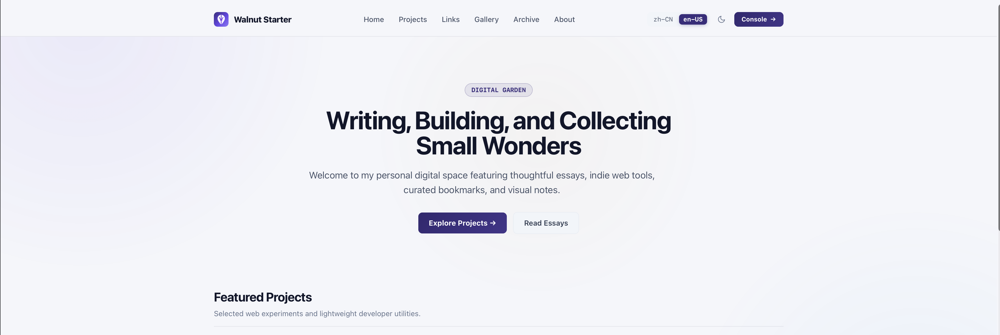

<div align="center">

# walnut-edge-cms-community

**专为 Cloudflare Workers、D1 与 R2 打造的轻量级边缘原生 CMS。**

[English](./README.md) · [简体中文](./README.zh-CN.md)

[](https://github.com/Meirgoo/walnut-edge-cms-community/releases)
[](https://workers.cloudflare.com/)
[](#开源协议)

[项目官网](https://walnut.meirgoo.com) · [在线演示](https://walnut-demo.meirgoo.com) · [反馈问题](https://github.com/meirgoo/walnut-edge-cms-community/issues)

</div>

> **Beta 提示 (`v0.9.0-beta.2`)**：Walnut CMS 社区版当前处于公测阶段。核心引擎、多站点架构与官方 `Univers` 主题已在线上稳定运行，部分文档与交互细节仍在持续打磨中，欢迎试用并提交 Issue 反馈。

<picture>
  <source media="(prefers-color-scheme: dark)" srcset="./repo_static/exmaple_dark.png">
  <source media="(prefers-color-scheme: light)" srcset="./repo_static/exmaple.png">
  
</picture>

---

## 什么是 Walnut CMS

walnut-edge-cms-community 是一个部署在Cloudflare Worker上的边缘建站工具，借助 Cloudflare 的生态工作，由于边缘生态以及应用本身的架构设计，存在以下特点：

- **边缘原生、零 VPS 维护**：直接跑在 Cloudflare Workers + D1 + R2，低内存与毫秒级响应，免费额度即可轻松托管。
- **多形态内容管理**：原生支持长文（Markdown / 双链 / 多语种）、轻量化微内容流，以及自定义结构化数据集（项目、书单、导航等）。
- **主题与数据解耦**：支持 ZIP / Git 一键导入换皮，切换主题不丢内容；内置 AI 契约，可直接配合外部 AI 生成主题与页面。
- **多站点与零信任安全**：单实例无限制托管多站点，后台原生对接 Cloudflare Access。

---

## 快速开始

### 前置条件

- 拥有一个 [Cloudflare](https://dash.cloudflare.com/) 账号（已开通 Workers、D1、R2 与 Zero Trust Access；Zero Trust 免费档自带 50 个活跃用户席位，个人使用免费）
- 本地安装 Node.js `>= 20`
- 启用Analytics Engine（部署时可跳过）

### 第一步：配置 Cloudflare Access（标准版必填，`nocfa` 版可跳过）

> 如需更短的部署路径，可在 [Releases](https://github.com/Meirgoo/walnut-edge-cms-community/releases) 下载 **`nocfa`** 发行包（移除了 Cloudflare Access 校验，部署更简单，但安全性低于标准版），并直接跳至第二步。

1. 进入 **Cloudflare Zero Trust → 访问控制（Access controls）→ 应用程序（Applications）→ 添加应用程序（Add an application）→ 自托管（Self-hosted）**。
2. 填写应用名称，在 **Public Hostname** 填入你的站点域名，并将 **Path（路径）** 填写为 **`admin`** *（切勿写成 `/admin*` 或带 `*` 通配符）*。
3. 在 **Policies（策略）** 中新建一条策略，将 **Action** 设为 **Allow** *（不要选 Bypass）*，在 Include 规则中填入你的邮箱，完成并**保存应用**。
4. 获取 **AUD（`CF_ACCESS_AUD`）**：应用保存后会自动生成 AUD。进入该应用的 **配置（Configure）→ 其他设置（Additional settings）**，在页面底部复制完整的 **Application Audience (AUD) Tag**。
5. 记录你的 **Team Name（`CF_ACCESS_TEAM_NAME`）**：在 Zero Trust 左侧 **设置（Settings）→ 自定义页面（Custom Pages）** 查看团队域名（`<前缀>.cloudflareaccess.com`），只填前缀即可（如 `myteam`）。

### 第二步：一键部署或源码启动

#### 方式一：使用发行包一键部署（推荐）

前往 [Releases](https://github.com/meirgoo/walnut-edge-cms-community/releases) 下载并解压 `walnut-cms-community.tar.gz`，在根目录运行零依赖交互式部署向导：

```bash
node deploy.mjs          # 自动识别系统语言 (zh / en)
node deploy.mjs --lang=zh
```

向导会自动完成登录状态检查、D1/R2 资源创建或复用、已有密钥保留、增量数据库迁移与主题静态资产同步。

#### 方式二：从源码本地开发与手动部署

```bash
git clone https://github.com/Meirgoo/walnut-edge-cms-community.git
cd walnut-edge-cms-community
npm install

# 将官方 Univers 主题静态资产同步至本地 R2
node scripts/sync-theme-assets.mjs --local

# 启动本地开发服务
npm run dev
```

从源码手动部署至远程 Cloudflare：

```bash
npm run deploy
# 确保远程 R2 已同步官方主题静态资产
node scripts/sync-theme-assets.mjs --remote
```

### 第三步：完成初始化并开始定制

访问 https://你的域名/admin/setup（标准版需先通过 Cloudflare Access 验证；nocfa 版需输入部署向导生成的一次性初始化密码）完成管理员创建与默认域名认领。

---

## 开源协议

本项目基于 [MIT License](./LICENSE) 开源。